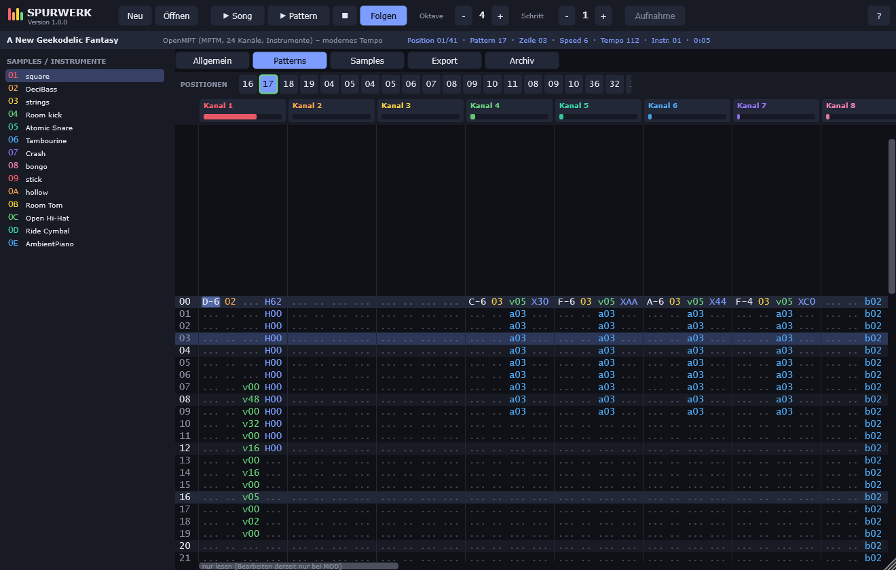
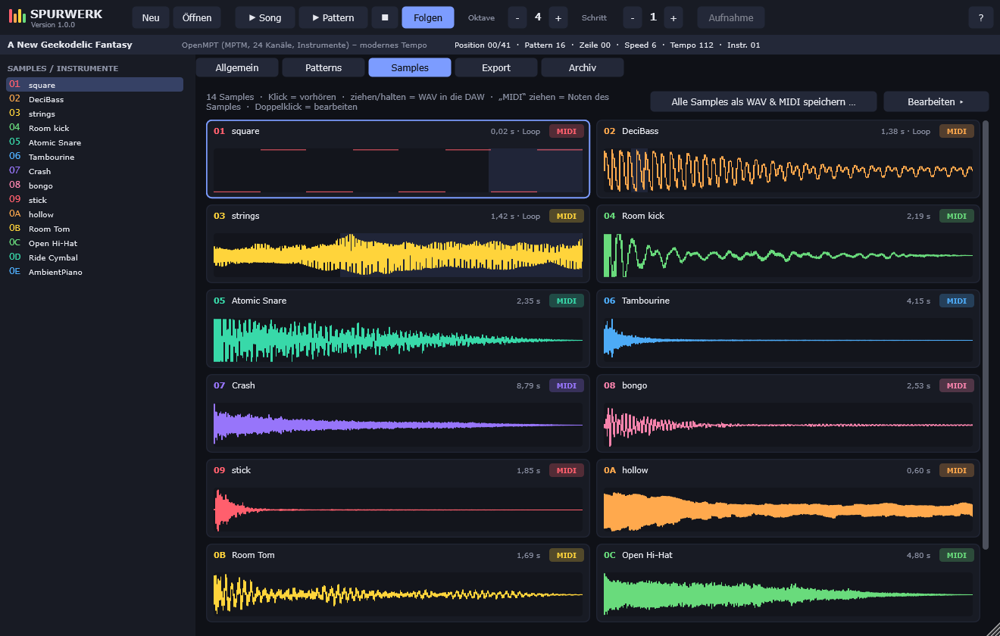
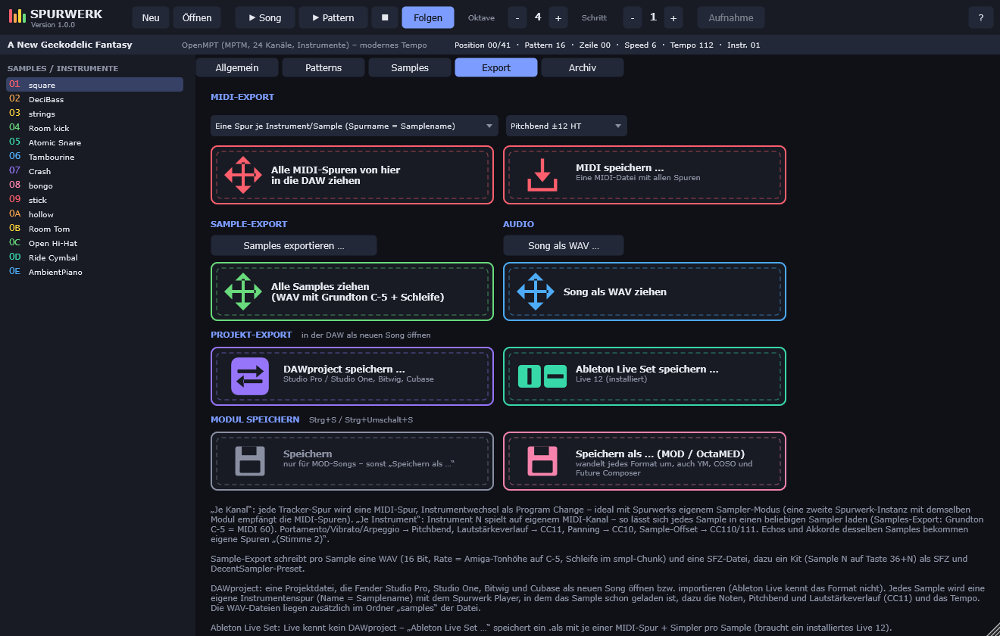
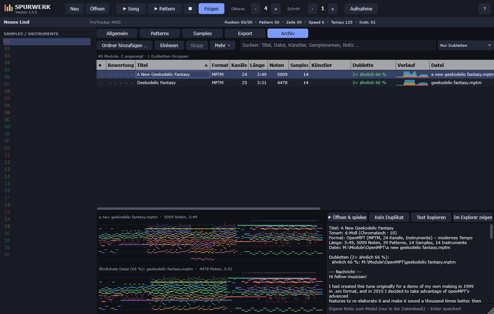
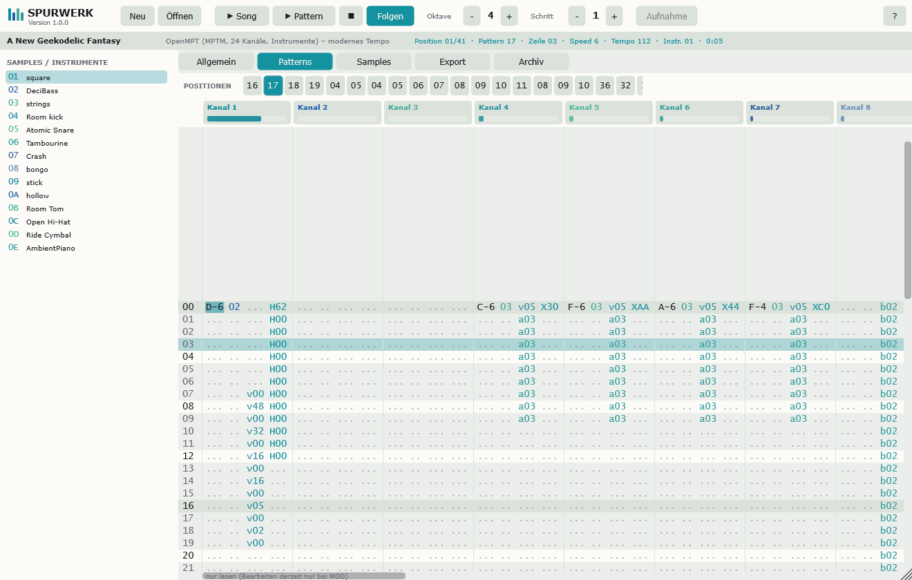

# Spurwerk – Tracker, Modul-Archiv und DAW-Brücke (VST3 / Standalone)

Spurwerk spielt und bearbeitet Tracker-Module – ProTracker-MOD, FastTracker-2-XM, Scream-Tracker-S3M, Impulse-Tracker-IT,
OpenMPT-MPTM, OctaMED, MultiTracker-MTM, Composer-669, Farandole-FAR, Digitrakker-MDL, Future Composer, TCB Tracker,
Oktalyzer-OKT – sowie Atari-ST-Chipmusik (YM, COSO). Es bringt die Musik in die DAW: als MIDI, als Samples mit Grundton
und Schleife, als WAV, als **DAWproject** (Fender Studio Pro / Studio One, Bitwig, Cubase) oder als **Ableton Live Set**.
Das **Archiv** durchsucht ganze Ordner nach Modulen, findet Dubletten an den Noten und macht Samplenamen und
Song-Nachrichten kopierbar. Läuft als VST3 in jeder DAW oder als eigenständiges Programm; Oberfläche auf Deutsch.
Bedienkonzept angelehnt an klassische PC-Tracker (OpenMPT/ModPlug Tracker, FastTracker) – Spurwerk hat keine Verbindung zu diesen Projekten.



## Download
Windows-Installer (VST3 + Standalone + Spurwerk Player): **[Releases](https://github.com/Yakobo1970/Spurwerk/releases/latest)** –
`Spurwerk-<Version>-Setup.exe` ausführen; die VST3s landen in `C:\Program Files\Common Files\VST3`.
Projektseite: https://www.undabtanzbar.de/software/spurwerk/

| Samples | Export |
|---|---|
|  |  |
| **Archiv mit Dubletten** | **Helles Thema** |
|  |  |

## Funktionen
- **MOD**: ProTracker/NoiseTracker (M.K., 4–32 Kanäle), Soundtracker mit 15 Samples – laden, bearbeiten, als .mod speichern
- **XM** (FastTracker 2): Instrumente mit Hüllkurven, Fadeout, Auto-Vibrato, Lautstärkespalte, lineare/Amiga-Frequenzen
- **IT** (Impulse Tracker/OpenMPT): Instrumente, gepackte Samples (IT 2.14/2.15), Lautstärke-/Pan-/Pitch-Hüllkurven, New Note Actions, Kanallautstärken
- **MTM** (MultiTracker, bis 32 Kanäle)
- **MPTM** (OpenMPT, inkl. Tempo-Modi) und **OctaMED/MED** (MMD0–MMD3, Abschnitte, BPM-Modus; Synth-Instrumente stumm)
- **Future Composer** 1.0–1.4 (SMOD/FC14, Instrument-Makros per eigenem Interpreter) und **TCB Tracker** (Atari ST)
- **669** (Composer 669/UNIS 669), **FAR** (Farandole Composer), **MDL** (Digitrakker 2/3 mit gepackten Samples und Instrumenten)
- **Gepackte Module**: PowerPacker (PP20), ZIP (.mdz/.s3z/.xmz/.itz) und GZIP werden beim Laden entpackt
- **S3M** (Scream Tracker 3) und **OKT** (Oktalyzer, bis 8 Stimmen)
- Bearbeiten im Pattern-Editor vorerst nur bei MOD; **Speichern als …** wandelt jedes Format in MOD oder OctaMED (bis 64 Spuren) um – auch YM, COSO und Future Composer
- **COSO** (Jochen Hippel, Atari ST): nachgebauter Hippel-Player rendert YM2149-Register, Teilsongs wählbar; mit echten YM-Aufnahmen abgeglichen
- **YM** (YM2/3/5/6, LHA-gepackt): eigene YM2149-Emulation mit Hüllkurven, Rauschen, SID-Stimmen, Digidrums, Sync-Buzzer; Anzeige als Pattern (nur lesend)
- Automatische Reparatur von Dateien, die bei einer Übertragung im Textmodus beschädigt wurden (LF → CR LF)
- Pattern-Editor mit Tastatur-Noteneingabe (QWERTZ/QWERTY), Hex-Eingabe, Auswahl, Kopieren/Einfügen, Transponieren, Undo/Redo
- Sample-Übersicht: alle Samples als Kacheln mit Wellenbild; Klick = vorhören, Ziehen = WAV in die DAW, „MIDI“ ziehen = Noten dieses Samples
- Sample-Editor: WAV/AIFF/FLAC laden, Schleifen ziehen, Lautstärke/Feinstimmung, als WAV speichern
- **MIDI-Export** (Datei oder Drag & Drop in die DAW): Spur je Kanal (Program Change) oder je Instrument; Effekte → Pitchbend/CC11
- **Sample-Export**: WAV mit Grundton und Schleife (smpl-Chunk), SFZ je Sample, Kit als SFZ und DecentSampler-Preset
- **Sampler-Modus**: MIDI-Eingang spielt die Samples des Moduls (bei YM: Rechteck-/Rauschstimme)
- **Spurwerk Player** (eigenes kleines VST3): spielt ein Sample aus einem geladenen Spurwerk-Modul auf allen 128 Tasten (C-5 = MIDI 60), Auswahl per Liste statt Drag & Drop – ideal für DAWs mit nur einem Plugin-Fenster (Fender Studio Pro); MIDI des Samples zum Herausziehen, Sample wird im Projekt gespeichert
- **DAWproject-Export** (Fender Studio Pro/Studio One, Bitwig, Cubase): je Sample eine Instrumentenspur mit Spurwerk Player samt Sample, Noten, Pitchbend, CC11 und Tempo; WAVs eingebettet; YM/COSO: die drei Chip-Stimmen exakt als Audiospuren, dazu stummgeschaltete Notenspuren mit Rechteck/Rauschen im Player
- **Archiv**: ganze Ordner nach Modulen durchsuchen, Katalog mit Suche, Bewertung, Favoriten und Notizen, Dublettensuche (identisch / gleiche Noten / ähnliche Melodie), Notenverlauf je Modul und im Vergleich zur ähnlichsten Datei, Tonart/Tongeschlecht/Skala, Samplenamen und Song-Nachricht zum Kopieren (Strg+C/Strg+Einf oder Knopf)
  - Titel, Künstler, Komponist und Arranger **direkt in der Tabelle** ändern – wie in einer Tabellenkalkulation, auch für mehrere markierte Zeilen auf einmal, mit Vorschlägen aus bekannten Namen und **Rückgängig** (Strg+Z); die Angaben stehen nur in der Datenbank, Moduldateien bleiben unangetastet
  - Sammelpool für fehlerhafte und ausgeschlossene Dateien, Rechtsklick: ausschließen / wieder aufnehmen / Datei in den Papierkorb
  - **Schreibschutz je Ordner** (z. B. Spieleordner): dort wird keine Datei gelöscht oder überschrieben, geschützte Einträge erscheinen rötlich
- **Ableton Live Set** (.als, Live 12): eigener Songordner mit Set und Samples, je Sample eine MIDI-Spur mit Simpler samt Sample, Noten + Pitchbend im Arrangement, Tempo; YM/COSO-Stimmen als Audiospuren (nutzt die Vorlagen der installierten Live-Version)
- Update-Hinweis: einmal am Tag wird das neueste GitHub-Release abgefragt (nur diese Anfrage, abschaltbar im Hilfe-Fenster)
- Song als WAV rendern, DAW-Sync (Start/Stopp, optional Tempo), Lupe (Rechtsklick), Anleitung und Info im Plugin, 6 Farbthemen hell/dunkel

## Lizenz
MIT-Lizenz, siehe [LICENSE](LICENSE). Teile beruhen auf NostalgicPlayer (MIT) und OpenMPT (BSD-3) – siehe
[THIRD_PARTY_NOTICES.md](THIRD_PARTY_NOTICES.md). Alle genannten Produktnamen gehören ihren Inhabern; sie beschreiben nur die Kompatibilität.

## Bauen
```
cmake -S . -B build -G "Visual Studio 18 2026" -A x64
cmake --build build --config Release
```
JUCE wird unter `%USERPROFILE%\JUCE` erwartet.

## Tests
- `EngineTest <outFolder|-|load> <Dateien…>` – Laden, Rendern, MIDI-Export, MOD-Round-Trip; `EngineTest dump <Modul>` – Kopf, Samples und alle Zellen
- `EngineTest scan <test.swdb> <Ordner>` – reiner Scan (Demo-Datenbank); `EngineTest archive <test.swdb> <Ordner>` – Archiv-Scan, Dubletten-Gruppen, Speichern/Laden (nie die echte Datenbank verwenden)
- `HostTest <Spurwerk.vst3> <Modul>` – lädt das Plugin wie eine DAW; `HostTest player <Spurwerk Player.vst3>` – Tonhöhe, Pitchbend, Zustand des Players
- `UiShot <out.png> <Modul> <Tab>` – Screenshots (Tab 4 = Archiv, Datenbank per Umgebungsvariable `SPURWERK_DB`), `UiShot keytest` – Tastatureingabe im Pattern-Editor

## Noch nicht unterstützt
Face The Music (.ftm), OctaMED-Synth-Instrumente, IT-Resonanzfilter, XPK/LHA-gepackte Module, YM-Tracker (YMT1/YMT2), Samples in COSO-DIGI-Varianten, SNDH. Speichern in anderen Formaten als MOD und OctaMED.
